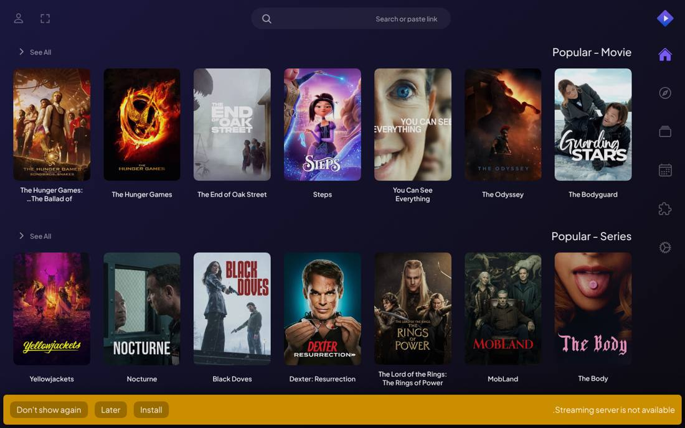
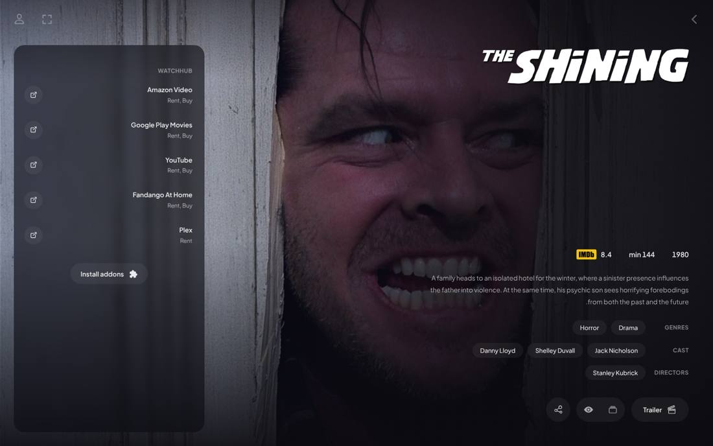
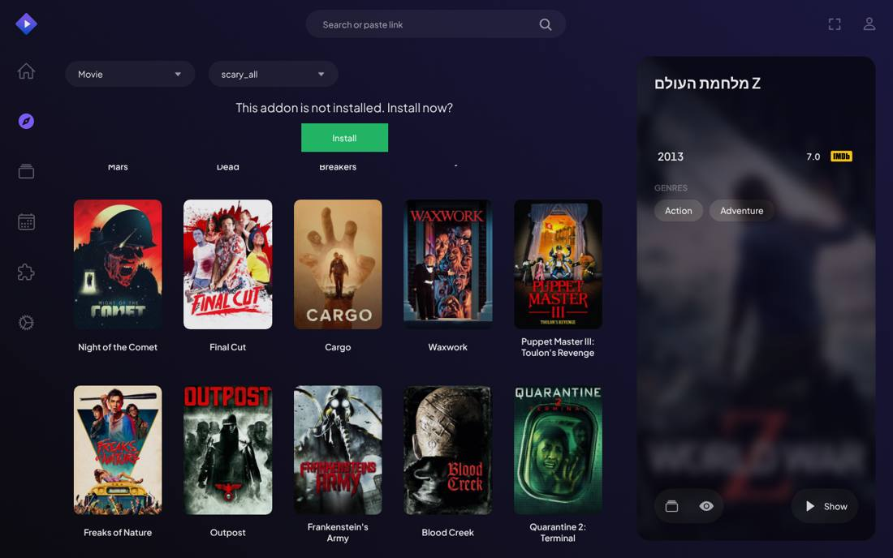

# שלב 0 — ממצאי ספייק האימות (26.11.2026)

נבדק על Stremio Web `9d096ae` (v5.2.0), בנוי ומורץ בדפדפן Chromium (Playwright), עם תוסף סטטי זמני שנוצר
מה-`feed.json` של SCARY. כל הקוד של הספייק זרוק ואינו בריפו. ✔ = נצפה בפועל.

## תוצאות

| # | שאלה | תוצאה | השלכה על התוכנית |
|---|---|---|---|
| 1 | האם Stremio Web נבנה ורץ כאן? | ✔ בנייה ב-28–31 שניות; האפליקציה עולה ומציגה את מסך הבית במצב אורח. | אפשר לפתח ולבדוק כאן. |
| 2 | לאן פונה האפליקציה **בלי חשבון**, מיד בעלייה? | ✔ `api.strem.io` ×3: `POST /api/getGeo` (מיקום לפי IP), `GET /config` (תצורה מרחוק), `POST /api/getModal` (חלון קידום). `www.gstatic.com` (Chromecast), `appleid.cdn-apple.com` (סקריפט Apple — נטען גם בלי מסך התחברות), `v3-channels.strem.io`, `caching.stremio.net` (Public Domain Movies), `cinemeta-catalogs.strem.io`, `v3-cinemeta.strem.io`, `images.metahub.space`, `live.metahub.space`, `127.0.0.1:11470` (חיפוש שרת סטרימינג מקומי). נשמר `installation_id` ב-localStorage. | "בלי מעקב" מחייב חסימה אקטיבית — ראו 3. |
| 3 | אפשר לחסום את `api.strem.io` בלי לפרק את ה-core? | ✔ **כן.** קובץ Worker משלנו שעוטף את `self.fetch` לפני טעינת ה-core: **0 בקשות** ל-`api.strem.io`/`www.strem.io`, והאפליקציה ממשיכה לעבוד (בית, עמוד כותר, גילוי, הגדרות). `remote_config` כבר לא נשמר. | **"שומר רשת"** ב-Worker = מנגנון הפרטיות המרכזי. ה-core נשאר ללא שינוי. `installation_id` נוצר מקומית ולא נשלח לשום מקום. |
| 4 | ה-core טוען קטלוג מתוסף סטטי **לא מותקן**? | ✔ כן (גילוי מציג את השורה, שמות בעברית), אבל **בלי דפדוף** ועם באנר "התוסף לא מותקן". | לא מספיק לבדו. |
| 5 | התקנת התוסף בפרופיל המקומי (בלי חשבון)? | ✔ עובד; **שום קריאה ל-Stremio API** בעקבות ההתקנה; מסך הבית טוען את כל 15 שורות SCARY; הדפדוף פועל. | **הוכרע: התוסף של SCARY מותקן אוטומטית בפרופיל המקומי**, וה-UI מציג רק את הקטלוגים שלו. |
| 6 | שמות קבצים סטטיים עם פרמטרים | ✔ `catalog/movie/scary_all/genre=zombie.json` נטען. ✔ בדפדוף ה-core מבקש `skip=100&genre=zombie.json` — **`skip` לפני `genre`** (לא כמו הסדר המקובל בדוגמאות). | המחולל יפיק את שני הסדרים; ערכי `genre` יהיו מזהי ASCII, והתרגום לשפת הממשק ייעשה ב-UI. |
| 7 | CORS ב-GitHub Pages | ✔ `access-control-allow-origin: *` (נבדק על תוסף סטטי רשמי לדוגמה של Stremio ב-github.io). | התוסף יעבוד גם ב-Stremio הרשמי. |
| 8 | RTL אוטומטי (`postcss-rtlcss` 6.0.0) | ✔ נבנה בלי שגיאות (344 כללי RTL). עם `dir="rtl"`: הבית, עמוד הכותר, הגילוי וההגדרות מתהפכים נכון. ✔ במצב ברירת המחדל של התוסף **חובה** ש-`dir` יוגדר תמיד על `<html>` (בלי `dir` הפריסה נשברת). | RTL בזמן בנייה — הפורק נשאר דק. תיקונים ידניים שנצפו: כיוון חיצים ("See All ›", "חזרה"), סדר "144 min", כיוון מחוון הזום. |
| 9 | עמוד כותר בלי חשבון | ✔ נטען מ-Cinemeta (לוגו, תקציר, שחקנים) + **WatchHub**: קישורי השכרה/קנייה חוקיים (Amazon, Google Play, YouTube, Plex). | מתאים ל"איפה לצפות" של SCARY; נשאיר את WatchHub. |
| 10 | מצב אורח ב-upstream | ✔ קיים ומלוטש: "Guest", "Saved in this browser", הגדרות Board/Spotlight. | "בלי התחברות" = הסרת נקודות הכניסה לחשבון, לא בנייה מחדש. |

## צילומי מסך מהספייק (עיצוב Stremio המקורי, לפני מיתוג)

| RTL אוטומטי — בית | RTL אוטומטי — עמוד כותר | קטלוג SCARY מתוסף סטטי |
|---|---|---|
|  |  |  |

## עוד לא נבדק
- שמות אפשרויות `genre` בעברית/ערבית בנתיבי קבצים (נעקף: מזהי ASCII + תרגום ב-UI).
- התנהגות ה-Service Worker (PWA) תחת תת-נתיב של GitHub Pages.
- ניגון בפועל (אין מקורות בסביבת הבדיקה).
- האם `cinemeta-catalogs.strem.io`, `v3-channels` ו-Public Domain Movies נטענים גם אחרי שה-UI מסנן לקטלוגי SCARY
  בלבד (המטרה: לא לפנות אליהם בכלל).

## הגבלת סביבת הפיתוח
`pnpm install` נכשל כאן ב-403 על `codeload.github.com` (4 תלויות `github:`), כי הסשן מורשה ל-tarballs רק של ריפוז
מצורפים. עקיפה מאומתת: משיכת אותם commits דרך git ו-`overrides` מקומי ל-`file:`. לא משפיע על GitHub Actions.
